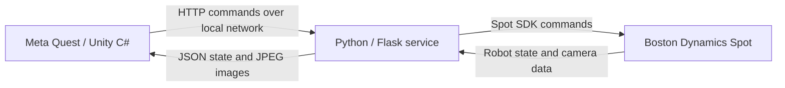

# VR Spot Controller

A personal R&D prototype connecting a Meta Quest / Unity application to Boston Dynamics Spot through a local Python / Flask service. VR inputs drive robot commands, while robot state and camera images return to Unity for an immersive view of the robot's surroundings.

[](https://youtu.be/mwNqkRPXPyY)

[Watch the project demo on YouTube](https://youtu.be/mwNqkRPXPyY) — Video language: Hungarian.

<!-- Add a project frame here: VR view with Spot camera feeds or controller-to-arm interaction. -->

## Overview

This experiment explores controlling Spot from an immersive Unity application and bridging C# with the Spot Python SDK. It was developed independently as a personal R&D project, using access to a Spot robot provided by my employer.

## Architecture



The Flask service translates HTTP requests into Spot SDK calls. Unity uses asynchronous HTTP requests and coroutines to update controls, state and camera surfaces. The real backend also uses a short timer to stow the arm after arm-transform updates stop.

## Key technical features

- Movement, yaw, body pitch, stand/sit, motor power-on and lease release controls. Lease release is distinct from a motor power-off command.
- Prototype arm mapping: enabling arm control captures the right controller's local pose; subsequent position deltas and relative rotations are converted between Unity and Spot coordinates and sent as arm poses. The server applies a fixed arm-position offset.
- Gripper control and a hand-camera view while arm control is active.
- Robot feedback: battery, pose/power state, body position/rotation and arm position/rotation.
- Five fisheye camera sources (back, front left/right, left/right) plus the hand camera. JPEG responses are decoded into Unity `Texture2D` objects.
- Runtime-generated curved image surfaces: `Sphere.cs` builds spherical mesh slices, with camera-specific orientation and UV direction, to arrange fisheye feeds around the user/Spot representation.
- A lightweight `FakeSpot` backend for hardware-free API development, using sample JPEGs and synthetic state. Its movement and state changes are simplified mock behavior.

## Repository structure

| Directory | Contents |
| --- | --- |
| `VRSpotController-Client/` | Unity / Meta Quest application, input actions, camera surfaces and HTTP client |
| `VRSpotController-Server/` | Flask bridge, request/response models, Spot SDK integration, mock backend and sample camera JPEGs |

## Technologies

Unity **6000.2.10f1**, C#, Meta Quest, OpenXR **1.15.1**, Meta OpenXR **2.2.1**, XR Interaction Toolkit **3.3.0**, Input System **1.15.0**, Python, Flask **3.1.3**, Boston Dynamics Spot SDK **5.1.1**.

## Setup

### Python service

Dependency installation and the hardware-free API tests were verified on Windows with Python **3.12.14**. Unity **6000.2.10f1** regenerated the input wrapper, compiled the project, checked the application prefabs and Main scene for missing scripts, and ran an eight-second Play Mode smoke check against the mock server with camera/state requests. No headset was connected, so OpenXR could not initialize a device. Dependency versions are pinned in `requirements.txt`.

```sh
cd VRSpotController-Server
python -m venv .venv
```

Activate the environment with `.venv\Scripts\Activate.ps1` in PowerShell, or `source .venv/bin/activate` on macOS/Linux, then:

```sh
python -m pip install -r requirements.txt
```

For a physical Spot, set `SPOT_IP`, `SPOT_USERNAME` and `SPOT_PASSWORD` in the process environment, then run:

```sh
python api.py
```

Real mode requires all three environment variables and network access to the robot. Supply real values locally; `.env` files are ignored and are not loaded automatically. Physical-robot operation has not been retested during this cleanup.

The local development server listens on port **5000**, on all network interfaces. Flask debug mode is off by default; `FLASK_DEBUG=1` enables it for local development.

### Hardware-free development

```sh
python api.py --mock
python -m unittest discover -p test_mock_api.py -v
```

Mock mode needs no robot credentials. It implements the same methods used by the service and reads the six sample camera JPEGs from the server directory, independently of the working directory. Tests cover every API endpoint, state transitions, camera responses, backend method signatures and missing-credential handling.

### Unity / Quest

1. Copy `Assets/_App/Resources/config.example.json` to `config.json` in the same directory. The runtime loads `Resources/config`; the local config and its generated `.meta` stay outside version control.
2. Use `127.0.0.1:5000` when Unity and the service run on the same computer. For Quest running separately, set `serverIP` to the server computer's LAN address and allow TCP port 5000 through its firewall.
3. Open `VRSpotController-Client/` in Unity **6000.2.10f1**, let packages import, then open `Assets/_App/Scenes/Main.unity` (the enabled build scene).
4. For a headset build, use the project's Android / OpenXR configuration and a compatible Meta Quest setup. Headset deployment and physical controls require device validation.

Edit input mappings in `Assets/_App/Input/UserInput.inputactions`; Unity generates `UserInput.cs` from that asset.

## Controls

Bindings below are taken from the Input Actions asset; headset behavior has not been retested during cleanup.

| Action | VR input | Keyboard development binding |
| --- | --- | --- |
| Move | Left thumbstick | WASD |
| Stand / sit | Left primary button | R |
| Power on / release lease | Left secondary button | P |
| Yaw / body pitch | Right thumbstick (dominant axis) | Arrow keys |
| Enable arm mapping | Right grip, held | Unbound |
| Gripper | Right trigger, while arm control is enabled | T / G |

## Project status

Experimental personal R&D prototype. It is not production-ready or a safety-certified robot-control solution. Arm mapping, camera presentation and the mock backend are prototyping tools; hardware behavior and Quest deployment need validation with the actual devices.

## Author

Tamás Harsányi — [Portfolio](https://www.tamasharsanyi.hu) · [GitHub](https://github.com/Harsanyi)
